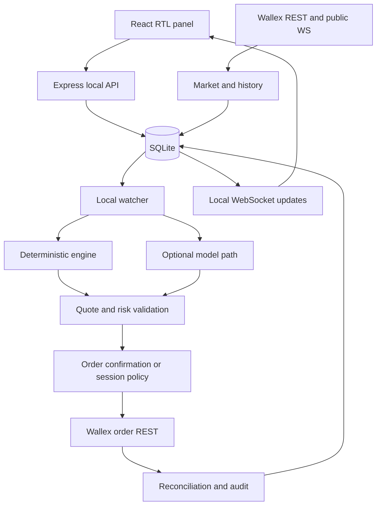

# معماری

`server.js` رابط، Express، SQLite و WebSocket را در یک فرایند اجرا می‌کند. در توسعه Vite middleware است؛ در production پوشهٔ `dist` سرو می‌شود. scheduler به مرورگر وابسته نیست. Docker، صف توزیع‌شده و میکروسرویس وجود ندارند.

| بخش | مسئولیت |
| --- | --- |
| `config/env.js` | تنظیمات؛ کلید فقط سمت سرور |
| `config/challenge-markets.js` | denylist برگزارکننده |
| `market-catalog.js` / `sync-markets.js` | تقاطع بازار، طرح و محدودیت محلی |
| `live-markets.js` / `live-candles.js` | قیمت و کندل رابط، تازگی |
| `history.js` / `incremental-history.js` | اعتبارسنجی و واکشی شکاف |
| `knowledge.js` | تاریخچه، سند و embedding |
| `market-watcher.js` / `rapid-strategy.js` | تغییر و سناریو از کندل بسته |
| `local-trader.js` | رتبه‌بندی بدون LLM و اندازه‌گذاری |
| `live-review-monitor.js` | جلسه، زمان‌بندی و توقف درخواست |
| `live-orders.js` | quote، پیش‌نویس، ارسال، تطبیق و حفاظت |
| `automatic-policy.js` | اختیار محدود کاربر، بدون شبکه |
| `agent-engine.js` | شبیه‌سازی جدا از سفارش واقعی |
| `agent-stream.js` | انتشار وضعیت شبیه‌سازی |

## مرز اختیار

سیگنال، پاسخ مدل یا رتبهٔ اول به‌تنهایی اختیار ارسال نیست. موجودی، دقت، هزینه، ریسک، بازار، عمر پیشنهاد و مجوز قبل از ارسال دوباره بررسی می‌شوند. تغییر `draft` به `submitting` اتمی است. نتیجهٔ مبهم `unknown` می‌شود و تکرار نمی‌شود.

مسیر محلی پیش از شبکهٔ LLM بازمی‌گردد؛ کنترل مستقل جلوی fallback یا تغییر موتور جلسه را می‌گیرد. این جداسازی مانع embedding یا بک‌تست مدلِ مستقل در بخش دیگر نیست.

## دوام و استقرار

schema با `CREATE TABLE IF NOT EXISTS` و تغییرات سازگار ساخته می‌شود؛ migration نسخه‌دار مستقل وجود ندارد. قبل از ارتقا backup بگیرید. جلسهٔ ذخیره‌شده ممکن است بعد از restart ادامهٔ پایش بدهد؛ restart را لغو مجوز فرض نکنید.

سرور به `127.0.0.1` bind می‌شود. احراز هویت چندکاربره و انتشار اینترنتی production پیاده نشده‌اند. عمومی‌کردن GitHub سرور برنامه را عمومی نمی‌کند.
