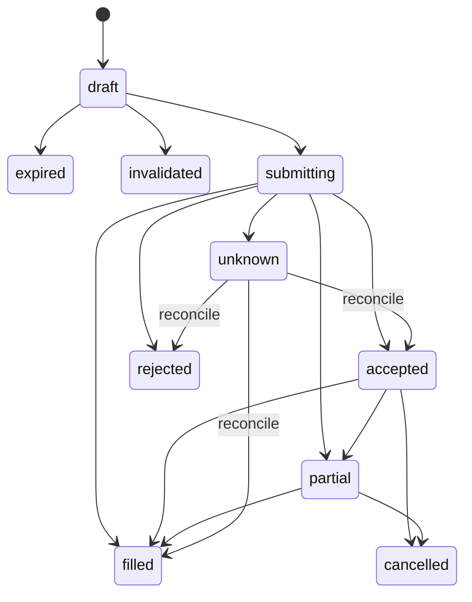

# چرخهٔ سفارش و مجوز جلسه

قابلیت سفارش با `LIVE_ORDER_REVIEW_ENABLED` فعال می‌شود. هویت حساب، طرح، بازار اسپات TMN، whitelist، فعال‌بودن ارز و هزینه پیش از ساخت و ارسال بررسی می‌شوند. کلیدِ خواندنی یا حساب فعال به‌تنهایی مجوز معامله نیست.

## دو روش اختیار

- `review`: همان پیش‌نویس با hash، token تأیید و پذیرش صریح کاربر ارسال می‌شود؛ انقضا ارسال نمی‌کند.
- `automatic`: کاربر سرمایه، مدت، تعداد ورود، ریسک، سقف زیان و ارزها را برای همان جلسه تأیید می‌کند. سرور به آن سیاست ذخیره‌شده متکی است. token جلسه، اختیار نامحدود نیست.

بودجهٔ مصرف‌شدهٔ ورود با بستن معامله خودکار به بودجهٔ مجوز برنمی‌گردد. رسیدن به سقف زیان، ورود تازه را می‌بندد؛ تضمین سقف نهایی زیان نیست. خروج خودکار باید متعلق به دارایی کسب‌شدهٔ همان جلسه باشد.

## نوع سفارش

محلی: LIMIT در ask خرید / bid فروش، با دقت صحیح صرافی. مدل: ممکن است MARKET بخواهد؛ اگر متادیتا `isMarketTypeEnable=false` بدهد، قبل از ارسال LIMIT جایگزین می‌شود. رد 422 یعنی سفارش ردشده را نباید به‌صورت کورکورانه تکرار کرد.

در جلسهٔ خودکار معتبر، باقیماندهٔ LIMIT سریع بعد از ۱۲۰ ثانیه برای لغو ارسال می‌شود. لغو می‌تواند دیر یا نامعلوم باشد؛ بخش پرشده بازگردانده نمی‌شود. در review یا جلسهٔ متوقف، لغو خودکار را فرض نکنید.

## کنترل quote

هزینه، spread، عمق، تازگی، گردکردن مقدار، حداقل سفارش، دارایی آزاد، تمرکز، ذخیرهٔ نقد، SL/TP و ریسک خالص سنجیده می‌شوند. ورود سطح ۱۰ در مسیر سریع حداقل نسبت خالص ۱٫۲ دارد؛ پیش‌فرض مسیر عادی ۱٫۵ است. quote پس از تغییر قیمت/دقت/کارمزد ممکن است رد شود؛ این خطا با رد تحلیل مدل متفاوت است.

## وضعیت‌ها

`accepted/NEW` یعنی پذیرفته‌شده، نه خرید انجام‌شده. سود از تغییر قیمت سفارش پرنشده ایجاد نمی‌شود. executedQty و executedSum مقدار واقعی اجرا را نشان می‌دهند.

## پاسخ نامعلوم و تکرار

هر سفارش client_id مستقل دارد. timeout بعد از ارسال ممکن است همراه پذیرش صرافی باشد؛ وضعیت `unknown` ورودهای تازه را تا تطبیق می‌بندد. از «تطبیق وضعیت» و پنل خود صرافی استفاده کنید. unknown را به failed تبدیل و دوباره ارسال نکنید.

## حفاظت اسپات

سرور bid جاری را با SL/TP مقایسه و در جلسهٔ خودکار معتبر برای موجودی واقعی کسب‌شده، خروج محدود می‌سازد. ابتدا باقیماندهٔ ورود جزئی را برای لغو مدیریت می‌کند. خروج به موجودی آزاد و مقدار واقعی محدود است.

این حدها سفارش حفاظتی بومی صرافی نیستند. سرور و جلسه باید فعال باشند؛ قطع پایش، خاموشی، انقضا یا کمبود موجودی می‌تواند حفاظت را متوقف کند. LIMIT خروج تضمین fill ندارد. بستن مرورگر سرور را متوقف نمی‌کند؛ restart ممکن است پایش جلسهٔ ذخیره‌شده را ادامه دهد.
